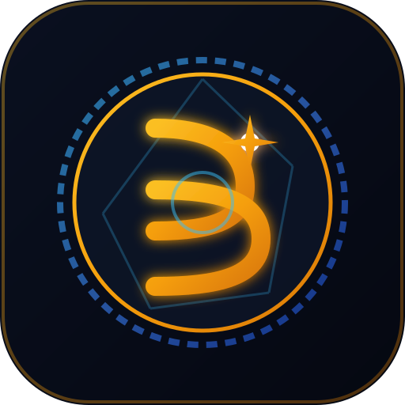

# 📱 BereaSnap PRO — Estudio Fotográfico Móvil

<p align="center">
  
</p>

<p align="center">
  <b>Aplicación profesional de revelado fotográfico y edición en lote para Android (100% Offline)</b><br>
  Diseñada para fotógrafos de eventos y comisiones de comunicación de <i>La Luz del Mundo</i>.
</p>

<p align="center">
  <a href="https://github.com/GaddiiHdez/LLDM-Photo/releases/latest">
    
  </a>
  <a href="https://github.com/GaddiiHdez/LLDM-Photo/actions/workflows/build-apk.yml">
    
  </a>
  
  
</p>

---

### 📲 Descarga de la Aplicación

Puedes descargar el archivo instalador oficial directamente en tu teléfono Android:

👉 [**Descargar Último APK (BereaSnap.apk)**](https://github.com/GaddiiHdez/LLDM-Photo/releases/latest/download/BereaSnap.apk)

*(O consulta el historial completo en [GitHub Releases](https://github.com/GaddiiHdez/LLDM-Photo/releases)).*

---

## ✨ Características Principales

### 🎚️ 1. Deck de Herramientas Ergonómico "Cero-Scroll"
Inspirado en la fluidez de **Lightroom Mobile y Snapseed**:
* **Arquitectura de 2 Filas Fijas:** Olvídate del scroll vertical en paneles comprimidos; cada herramienta opera en dos niveles horizontales limpios:
  * **Fila Superior:** Slider maestro activo con indicador numérico en vivo (`+15`, `-20`), botones de 1 toque (`Auto`, `0`, `Todo`, `Sync`).
  * **Fila Inferior:** Cinta deslizable con difuminado suave (*soft-edge content fade*) que muestra todas las opciones y diales de un vistazo.
* **5 Módulos Dedicados:** `Filtros`, `Ajustes`, `Encuadre`, `Firma`, `Marcos`.

### 🎞️ 2. Carrete Filmstrip Inteligente
* **Cinta Persistente (50px):** Acceso permanente a todas las fotografías de la sesión bajo el lienzo, con centrado automático suave de la toma activa.
* **Cápsula de Acción Directa:**
  * **`🔄 Sustituir`:** Reemplaza la foto seleccionada por otra de tu galería conservando intactos su lugar en el lote, sus ajustes de revelado, recorte, marco y firma.
  * **`🗑️ Borrar`:** Elimina la toma actual con 1 toque y selecciona de inmediato la foto contigua.
  * **`⊞ Lote`:** Abre la cuadrícula completa de la sesión para supervisar y gestionar el lote en grande.

### 📷 3. Motor de Revelado RAW 14-Bit (Offline)
* Decodificación y procesamiento acelerado directamente en el procesador del dispositivo:
  * Nikon (`.NEF`), Canon (`.CR2`), Sony (`.ARW`), Fujifilm (`.RAF`) y Adobe (`.DNG`).
* Calibración adaptativa inteligente para templos e iluminación de eventos (exposición, contraste, sombras, balance de blancos, reducción de ruido y enfoque).

### 🏛️ 4. Marcos Dinámicos Fine-Art & Centenario
* Plantilla oficial **Centenario** con texto dinámico en tiempo real.
* Renderizado tipográfico en **Cinzel Imperial** con relieve y gradiente metálico dorado idéntico al marco original.
* Chips de evento rápidos: *Escuela Dominical, Oración 7:00 PM, Culto de Jóvenes, Consagración, Bautismos, Servicio Especial*.
* Marcos digitales adicionales: *Galería Fine-Art, Editorial con pie de foto, Filo de Oro, Polaroid*.

### ✍️ 5. Firma y Catálogo de Logos
* Selector visual de 5 cuadrantes (`↖`, `↗`, `•`, `↙`, `↘`).
* Ajuste fino de tamaño y opacidad.
* Subida y persistencia local de logos PNG personalizados en IndexedDB.

### 🔄 6. Actualizador Integrado (In-App APK Updater)
* Detección automática al abrir la aplicación cuando existe una nueva versión en GitHub Releases.
* Notificación con notas de la versión y descarga directa del APK a la memoria del teléfono para actualizar con 1 toque.
* Respeto total al modo offline si no hay conexión a internet.

---

## 🏷️ Sistema de Versionado Semántico (SemVer)

BereaSnap sigue el estándar [SemVer](https://semver.org/lang/es/) (`MAJOR.MINOR.PATCH`):

| Tipo | Formato | Cuándo se incrementa | Ejemplo |
| :--- | :--- | :--- | :--- |
| **PATCH** | `1.0.X` | Correcciones de errores menores, parches de estilo o textos. | `1.0.1` |
| **MINOR** | `1.X.0` | Nuevas funciones, nuevos marcos, módulos o mejoras de UI. | `1.1.0` |
| **MAJOR** | `X.0.0` | Rediseños estructurales grandes o cambios de plataforma. | `2.0.0` |

### Cómo lanzar una nueva versión:
Para publicar una nueva versión, solo actualiza la versión en `package.json`:
```bash
# Para cambios menores
npm version patch

# Para nuevas funciones
npm version minor

# Para versiones mayores
npm version major
```
Al hacer `git push origin main`, **GitHub Actions** detecta la versión automáticamente, compila el APK y publica el release con el nombre correspondiente (ej. `BereaSnap-v1.1.0.apk`).

---

## 📂 Estructura del Proyecto

```text
LLDM-Photo/
├── .github/workflows/
│   └── build-apk.yml          # Pipeline CI/CD para compilar y publicar APK
├── android/                   # Proyecto nativo Android (Capacitor)
│   ├── app/
│   │   └── build.gradle       # Configuración Gradle, versionCode y SDK
│   └── capacitor-cordova-android-plugins/
├── public/
│   ├── frames/                # Marcos PNG oficiales (Centenario, etc.)
│   └── logo-bereasnap*.svg    # Identidad y logos vectoriales
├── src/
│   ├── components/
│   │   ├── Header.tsx         # Barra superior con estado de versión y lote
│   │   ├── PreviewStage.tsx   # Lienzo de renderizado HDR y gestos táctiles
│   │   ├── SidebarControls.tsx# Deck de 2 filas cero-scroll (filtros, ajustes, encuadre)
│   │   ├── ThumbnailBar.tsx   # Carrete persistente y cuadrícula de lote
│   │   ├── UpdateModal.tsx    # Modal de comprobación y descarga de actualizaciones
│   │   └── ExportModal.tsx    # Exportación individual y ZIP
│   ├── services/
│   │   └── updateService.ts   # Consulta a GitHub Releases y descarga de APK
│   ├── utils/
│   │   ├── canvasEngine.ts    # Motor de renderizado de marcos y marcas de agua
│   │   ├── rawProcessingEngine.ts # Algoritmos de ajuste de luz, color y contraste
│   │   └── rawDecoder.ts      # Decodificación de archivos RAW
│   ├── version.ts             # Constante de versión sincronizada
│   ├── App.tsx                # Orquestador principal de estado
│   └── index.css              # Sistema de diseño de Cuarto Oscuro móvil
├── capacitor.config.json      # Configuración de Capacitor Android
└── package.json               # Dependencias, scripts y versión semántica
```

---

## 🛠️ Desarrollo Local

### Requisitos Previos
* Node.js 20+ o 22+
* npm 9+

### Instalación y Ejecución
```bash
# 1. Instalar dependencias
npm install

# 2. Iniciar servidor de desarrollo local
npm run dev

# 3. Compilar aplicación web
npm run build

# 4. Sincronizar cambios con Android
npm run cap:sync
```

---

## 📄 Licencia y Derechos

Desarrollado exclusivamente para la comisión de fotografía y difusión institucional de **La Luz del Mundo (LLDM)**. Todos los logotipos, insignias y tipografías oficiales son marcas registradas de sus respectivos titulares.
